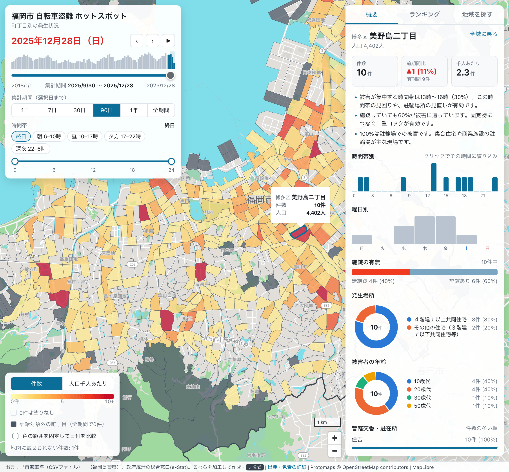

# Fukuoka Bicycle Thefts Prediction



Interactive map of bicycle thefts in Fukuoka city by 町丁目 (census small area), with a
date/time slider, a theft-count or per-capita choropleth, and a detail panel aimed at both
residents and police. Prediction is not implemented yet.

## Layout

- `backend/`: Python (uv) data pipeline and FastAPI service. Run commands from here, e.g. `uv run pipeline`.
- `frontend/`: React + TypeScript (pnpm, Vite) map UI. Run `pnpm dev` from here.
- `data/`: raw and processed data, shared by both (not tracked).

## Setup

### 1. Data

Place the yearly theft CSVs from the Fukuoka Prefectural Police under `data/raw/bicycle-thefts/`
and the e-Stat census files listed below under `data/raw/census/`. Then, in `backend/`:

```sh
uv sync
uv run pipeline           # raw theft CSVs -> data/processed/fukuoka_bicycle_thefts.parquet
uv run build-areas        # census shapefiles -> data/processed/fukuoka_areas.{geojson,parquet}
uv run download-pmtiles   # Protomaps basemap clipped to the city -> data/raw/fukuoka.pmtiles (needs the `pmtiles` CLI)
```

### 2. Run

```sh
cd backend && uv run api          # FastAPI on http://127.0.0.1:8000 (serves /api/* and /tiles/fukuoka.pmtiles)
cd frontend && pnpm install && pnpm dev   # Vite on http://localhost:5173, proxies /api and /tiles to the backend
```

### Keeping the API types in sync

Response models are Pydantic classes in `backend/src/bicycle_theft/api/schemas.py`. After changing
them or any endpoint:

```sh
cd backend && uv run export-openapi    # writes backend/openapi.json
cd frontend && pnpm generate:api       # regenerates frontend/src/client with @hey-api/openapi-ts
```

### Basemap style

`frontend/src/basemap-style.json` is generated from `@protomaps/basemaps` (light flavor, Japanese
labels). Regenerate it after upgrading the package:

```sh
cd frontend && pnpm generate_style
```

## Dataset

### Theft data

Bicycle theft records (自転車盗) from the Fukuoka Prefectural Police, published on the
[福岡県オープンデータカタログサイト](https://data.bodik.jp/organization/400009) (creator: 福岡県警察本部生活安全部生活安全総務課).
Save each CSV under `data/raw/bicycle-thefts/` with its original file name.

| Year | Dataset | CSV |
|---|---|---|
| 2018 | [400009_hanzai](https://data.bodik.jp/dataset/400009_hanzai) | https://data.bodik.jp/dataset/763a6afc-942a-412f-adbf-70c13b96cc36/resource/6b57786a-9b2a-4a54-a252-0bc9233ebfcd/download/fukuoka_2018zitensyatou.csv |
| 2019 | [400009_hanzai_r1](https://data.bodik.jp/dataset/400009_hanzai_r1) | https://data.bodik.jp/dataset/f3bbb8e9-4bf6-46e4-ac3f-a1bef559cae8/resource/2dd10155-171c-442b-88ac-f887435e8b8b/download/fukuoka_2019zitensyatou.csv |
| 2020 | [400009_hanzair2](https://data.bodik.jp/dataset/400009_hanzair2) | https://data.bodik.jp/dataset/c6275753-94ca-40b5-98e2-e93cd3d7a9a2/resource/85ec1ab4-d2d2-4125-a8e1-68d8f9de0169/download/fukuoka_2020zitenshatou.csv |
| 2021 | [400009_hanzair3](https://data.bodik.jp/dataset/400009_hanzair3) | https://data.bodik.jp/dataset/81eade23-8b71-4311-9978-5b48b66e332d/resource/347542ed-8c76-4f58-b724-c824895b6b91/download/fukuoka_2021zitensyatou.csv |
| 2022 | [400009_hanzair4](https://data.bodik.jp/dataset/400009_hanzair4) | https://data.bodik.jp/dataset/9a43c945-71c4-4150-8ec4-676748c9b2d0/resource/780a31b4-5367-4468-875e-fb72af05410c/download/fukuoka_2022zitensyatou.csv |
| 2023 | [400009_hanzair5](https://data.bodik.jp/dataset/400009_hanzair5) | https://data.bodik.jp/dataset/94ef6035-ccf3-4b68-97e7-1d0ade65f108/resource/3edc6b1e-a3e7-41be-909c-706eb013e2fc/download/fukuoka_2023zitensyatou.csv |
| 2024 | [400009_hanzair6](https://data.bodik.jp/dataset/400009_hanzair6) | https://data.bodik.jp/dataset/c86326fe-655b-4eb0-a0fe-e29f163f31aa/resource/3357a675-7deb-4955-9840-13a57d4b7c9d/download/fukuoka_2024zitensyatou.csv |
| 2025 | [400009_hanzair_r7](https://data.bodik.jp/dataset/400009_hanzair_r7) | https://data.bodik.jp/dataset/e3f82fc2-92d5-4355-a1ad-9ee2df23ab2b/resource/52a9a4dd-fb7b-4fb6-a7f2-63eac8f63b74/download/fukuoka_2025zitensyatou.csv |

### Boundary data

#### Download page
https://www.e-stat.go.jp/gis/statmap-search?page=1&type=2&aggregateUnitForBoundary=A&toukeiCode=00200521&toukeiYear=2020&serveyId=A002005212020&prefCode=40&coordsys=1&format=shape&datum=2011

#### Download links

Unzip each archive into `data/raw/census/boundary/<archive name>/`.

40131	福岡市東区	https://www.e-stat.go.jp/gis/statmap-search/data?dlserveyId=A002005212020&code=40131&coordSys=1&format=shape&downloadType=5&datum=2011
40132	福岡市博多区	https://www.e-stat.go.jp/gis/statmap-search/data?dlserveyId=A002005212020&code=40132&coordSys=1&format=shape&downloadType=5&datum=2011
40133	福岡市中央区	https://www.e-stat.go.jp/gis/statmap-search/data?dlserveyId=A002005212020&code=40133&coordSys=1&format=shape&downloadType=5&datum=2011
40134	福岡市南区	https://www.e-stat.go.jp/gis/statmap-search/data?dlserveyId=A002005212020&code=40134&coordSys=1&format=shape&downloadType=5&datum=2011
40135	福岡市西区	https://www.e-stat.go.jp/gis/statmap-search/data?dlserveyId=A002005212020&code=40135&coordSys=1&format=shape&downloadType=5&datum=2011
40136	福岡市城南区	https://www.e-stat.go.jp/gis/statmap-search/data?dlserveyId=A002005212020&code=40136&coordSys=1&format=shape&downloadType=5&datum=2011
40137	福岡市早良区	https://www.e-stat.go.jp/gis/statmap-search/data?dlserveyId=A002005212020&code=40137&coordSys=1&format=shape&downloadType=5&datum=2011

### Population data

Population per 町丁目 comes from the `JINKO` attribute of the boundary shapefiles (2020 census).
The age breakdown table below is downloaded for later use.

#### Download page
https://www.e-stat.go.jp/gis/statmap-search?page=2&type=1&toukeiCode=00200521&toukeiYear=2020&aggregateUnit=A&serveyId=A002005212020&statsId=T001082

#### Download link
https://www.e-stat.go.jp/gis/statmap-search/data?statsId=T001082&code=40&downloadType=2

### PMTiles

Run `uv run download-pmtiles` in `backend/` to download PMTiles for Fukuoka city.

## Data sources and licenses

The raw and processed datasets are not committed (`data/` is ignored); each source keeps its own
terms. The map shows
the credits in its attribution footer, and `frontend/public/credits.html` (served as `/credits.html`)
lists every resource URL, the processing done here and the disclaimer.

| Data | Terms | Credit |
|---|---|---|
| Theft CSVs, Fukuoka Prefectural Police | CC BY for 2018–2024 (the catalog's default is CC BY 2.1 JP), CC BY 4.0 for 2025; the police's own rules follow 政府標準利用規約 2.0, compatible with CC BY 4.0 | 出典：「自転車盗（CSVファイル）」（福岡県警察）（resource URL）, plus a separate statement that the data was processed (加工して作成) |
| Census boundaries and `JINKO` population, e-Stat (総務省統計局) | [e-Stat 利用規約](https://www.e-stat.go.jp/terms-of-use), 政府標準利用規約 2.0, compatible with CC BY 4.0 | 出典：政府統計の総合窓口(e-Stat)（https://www.e-stat.go.jp/）, plus the processing statement |
| Basemap tiles, OpenStreetMap via Protomaps | ODbL 1.0 (Protomaps distributes the build as a Produced Work) | © OpenStreetMap contributors, linked to https://www.openstreetmap.org/copyright |
| Fonts and sprites from `protomaps.github.io/basemaps-assets` | SIL OFL 1.1 (Noto Sans), MIT (icons) | Loaded from the CDN, nothing to ship |

The processed outputs in `data/processed/` and anything derived from them carry the same credits.
This site is an unofficial project: it is not made, provided or endorsed by the Fukuoka Prefectural
Police, Fukuoka Prefecture or the Statistics Bureau, and the counts, trends and prevention tips it
shows are its own aggregation of the data above.

## License

The source code is licensed under the [Apache License 2.0](LICENSE); see [NOTICE](NOTICE). The
licence does not cover the data described above. Files copied or generated from other projects
(the Hey API client runtime and the Protomaps basemap style) keep their licences, listed in
[THIRD_PARTY_NOTICES.md](THIRD_PARTY_NOTICES.md). `pnpm build` writes the licences of every bundled
library to `frontend/dist/third-party-licenses.md`: what Vite collects from `node_modules`, the
packages maplibre-gl bundles inside its own build, and `THIRD_PARTY_NOTICES.md`.

## Verification and audit

Use Python 3.15+, Node.js 24 and pnpm 12.15.0 (pinned in `frontend/package.json`).

```sh
cd backend
uv sync --frozen
uv run python -m unittest discover -s tests -v
uv run ruff check src tests
uv run ruff format --check src tests
cd ../frontend
pnpm install --frozen-lockfile
pnpm test
pnpm lint
pnpm build
```

Tests use synthetic fixtures and need no untracked datasets. GitHub Actions also checks generated API drift and dependency advisories, including a weekly scan. The pnpm workspace settings restrict dependency build scripts to esbuild and require a patched js-yaml version for API generation.

The API bug-fix release is **0.1.1**. Invalid windows now return 422 instead of overflowing, unknown timeline areas return 404, and timelines include zero-count months. Existing successful response shapes are preserved.

The [repository audit](docs/audit/README.md) links the findings in Markdown, JSON and CSV, test evidence, dependency scan results, limitations and performance measurements. For production, serve the frontend build behind a same-origin reverse proxy for `/api` and `/tiles`; the Vite development proxy does not configure production hosting.
